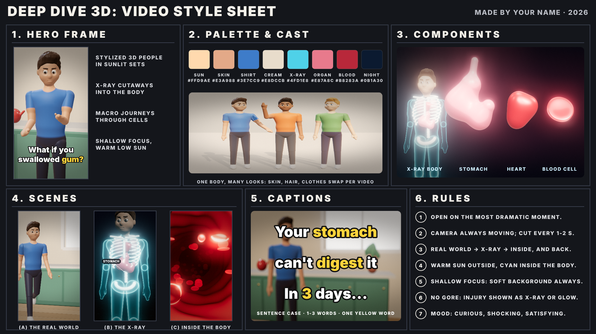
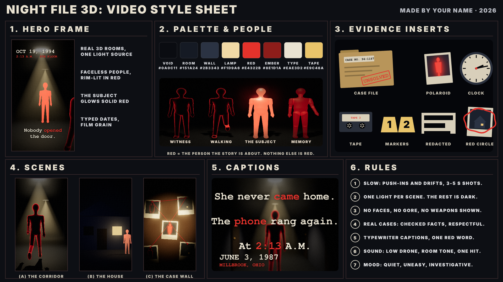
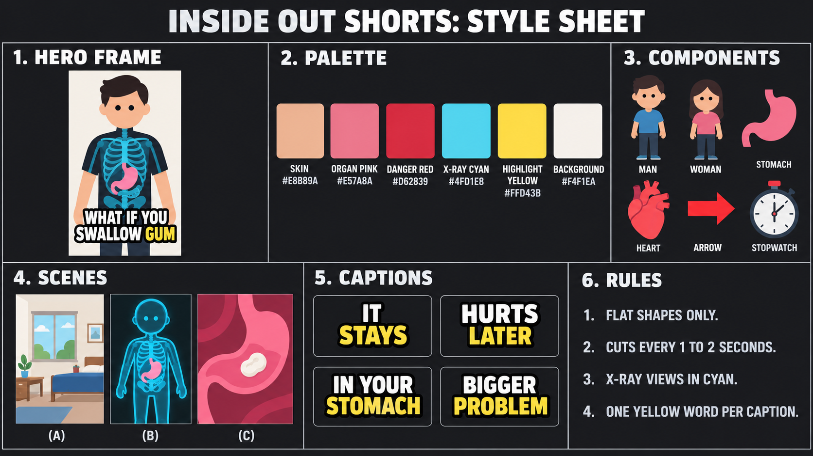
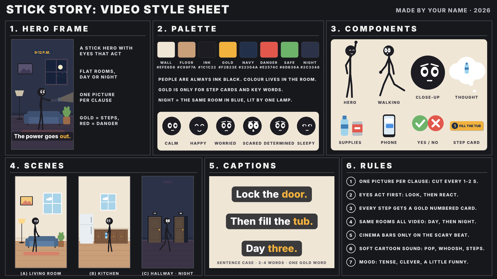
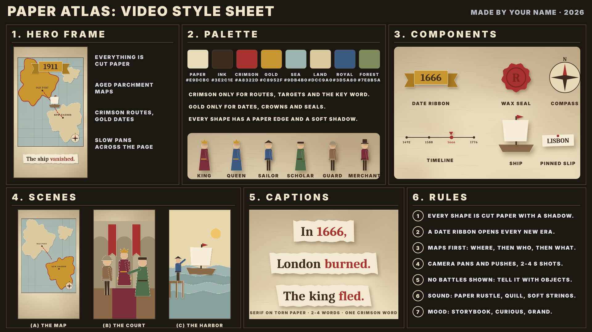
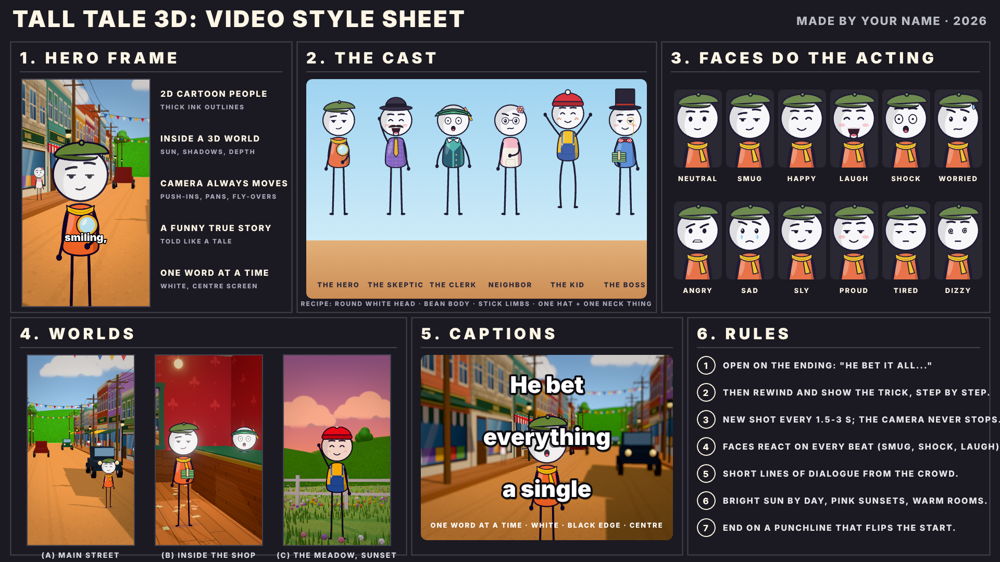

# Faceless Shorts — a free skill for AI agents

**Narrated faceless shorts for YouTube Shorts, TikTok and Reels, made 100% in code on your own computer.**
Script, AI voice, word‑synced captions, animation, sound effects and music — rendered to an MP4.
No AI video, no image generation, no API keys, no credits, **$0 per video**.



Six hand‑built visual styles. You give a topic, the agent writes and renders the whole short.

---

## Install (30 seconds)

**The easy way — hand the ZIP to your AI agent:**

1. Click **`Code ▾` → `Download ZIP`** on this page.
2. Upload / attach that ZIP to your AI agent (Claude Code, Cursor, Windsurf, Codex, anything that can read files and run a shell).
3. Say: **“Install this skill.”**

That's it. The agent unzips it to `~/.claude/skills/faceless-shorts/`, runs the setup script, downloads the free local
voice + Whisper models, and runs the self‑test until it prints `SELFTEST PASSED`.

**Manual install** (if you'd rather do it yourself):

```bash
unzip Faceless-Shorts-Skill-main.zip
mv Faceless-Shorts-Skill-main ~/.claude/skills/faceless-shorts
bash ~/.claude/skills/faceless-shorts/scripts/setup.sh     # prints "All set"
bash ~/.claude/skills/faceless-shorts/scripts/selftest.sh  # prints "SELFTEST PASSED"
```

Start a new session, then ask for a short.

> **Windows:** run the scripts in Git Bash (it comes with Git for Windows).

---

## Make your first short

Just describe it. A topic is enough:

> Make a Deep Dive 3D short: what happens if you crack your knuckles?

> Night File 3D about the man who jumped out of a plane.

> Stick Story: what would you do if the power went out for three days?

The agent works in five steps, and stops for you twice: picks the style (or asks once), shows you **the full narration +
shot list + facts and sources in one screen** and waits for *“Build it?”*, then builds, **checks every frame of a contact
sheet before showing you the video**, and hands over the MP4 with a title, caption, hashtags and a cover frame.

Everything is editable afterwards: change one line, one shot, the voice, the music, the end card — and it re‑renders only
what changed.

---

## The six styles

| | |
|---|---|
| **Deep Dive 3D** — the flagship. Zack D. Films‑like “what happens if…?” body and science explainers: sculpted 3D people in sunlit sets, glowing x‑ray bodies, camera journeys through blood vessels, shallow focus.<br><br>*Example: “What happens if you hold your breath?”* |  |
| **Night File 3D** — unsolved mysteries and true crime. Dark 3D places with a single light, faceless people where the subject glows red, typewriter dates, case‑file inserts.<br><br>*Example: “The man who jumped out of a plane” (D.B. Cooper).* |  |
| **Inside Out** — flat 2D “what happens if…?” explainers. A simple hero, x‑ray cutaways, bold 1–3 word captions, punchy cuts.<br><br>*Example: “What if you swallow gum?”* |  |
| **Stick Story** — “what would you do if…?” survival steps. Stick people with acting eyes, flat rooms day and night, gold step cards.<br><br>*Example: “What if the power went out for 3 days?”* |  |
| **Paper Atlas** — history in cut paper. Parchment maps, crimson routes, gold date ribbons, period figures.<br><br>*Example: “How one bakery burned down London.”* |  |
| **Tall Tale 3D** — funny true stories. Flat 2D cartoon people (big round heads, ink outlines) acting in a sunny 3D small‑town world, camera always moving, one‑word captions.<br><br>*Example: “The girl who was mailed to grandma.”* |  |

Every style ships as three things: `style-sheet.png` (the whole look in one image, drawn by that style's own code),
`STYLE.md` (its rules plus the engine manual) and `example/` — **a complete finished project that renders as‑is**, so you
can see a real short in that style before writing your own.

**Which style for which idea?**
body / health / science → **Deep Dive 3D** (or **Inside Out** for a lighter 2D look) ·
creepy, unexplained, true crime → **Night File 3D** ·
survival, “here's what you do” → **Stick Story** ·
a historical event → **Paper Atlas** ·
a funny or clever true story, a con, a loophole → **Tall Tale 3D**.

---

## How it works

```
script.json
   │  Kokoro voice (local, free)          ──►  voice.wav
   │  Whisper word timings (local, free)  ──►  per-word timestamps
   ▼
shots drawn in code (canvas 2D / three.js)
   │  every cut and caption placed on its word
   │  procedural sound effects + music (numpy)
   ▼
headless Chrome captures every frame  ──►  ffmpeg  ──►  renders/<name>.mp4  (1080×1920)
```

- **No AI images or AI video.** Every shot is code: canvas drawing or real three.js geometry.
- **Local voice, local timing.** Kokoro‑82M and Whisper small.en run on your machine, once, for free.
- **Word‑synced captions** land on the exact word being said, with one highlighted word per caption.
- **The agent QAs itself** on a time‑stamped contact sheet of the whole video before you ever see it.

---

## What it needs

| | |
|---|---|
| Claude Code (or any agent with a linked computer and a shell) | required |
| Node.js 22+ | required |
| ffmpeg | required |
| Google Chrome | required (headless frame capture) |
| Python 3.10+ | required (voice + timing) |
| ~1 GB free disk | for the Kokoro voice (~340 MB) and Whisper small.en (~0.5 GB) |

The agent installs anything that's missing the free, official way — and asks before anything needs a password.
A GPU makes the 3D styles fast; without one they still render, just slower (the agent tells you the render time up front
and runs it in the background).

---

## Optional: publish straight to YouTube

If you ask, the agent can upload the finished short to your YouTube channel through Zapier. It confirms **title,
visibility and category** with you first, hosts the file on a temporary link, uploads, and gives you back the URL.
It never uploads or spends anything unless you ask and confirm.

---

## Repo layout

```
SKILL.md                     what the agent follows (the whole workflow)
scripts/
  setup.sh  selftest.sh      one-time install + proof everything works
  new_video.sh               copy a style's example project to ~/faceless-shorts/<name>/
  voice.py  words.py         local voice + word timings
  estimate.py                captions-only projects (no voiceover yet)
  py                         the project's Python (the venv)
styles/<style>/
  style-sheet.png            the look in one image
  STYLE.md                   the rules + engine manual
  example/                   a complete project that renders as-is
```

Your own projects are created in `~/faceless-shorts/<short-name>/` and never touch this folder.

---

## FAQ

**Does it cost anything?** No. No API keys, no credits, no subscriptions. Only your own electricity.

**Can I use the output commercially?** The code, stories, drawings and sound are original and free to use in your videos.

**Can I add my own voiceover?** Yes — record after you've seen the script and the agent syncs the captions to your audio
(`words.py --audio`). There's also a captions‑only mode if you want to add the voice yourself later.

**Can I make a new style?** Ask. The skill documents how to build one: a style sheet, a STYLE.md and a working example,
and the shared scripts keep working unchanged.

**Licenses:** Inter font — SIL Open Font License 1.1. Installed on first use: Kokoro‑82M (Apache‑2.0) via kokoro‑onnx (MIT),
faster‑whisper + Whisper small.en (MIT), numpy, scipy.
